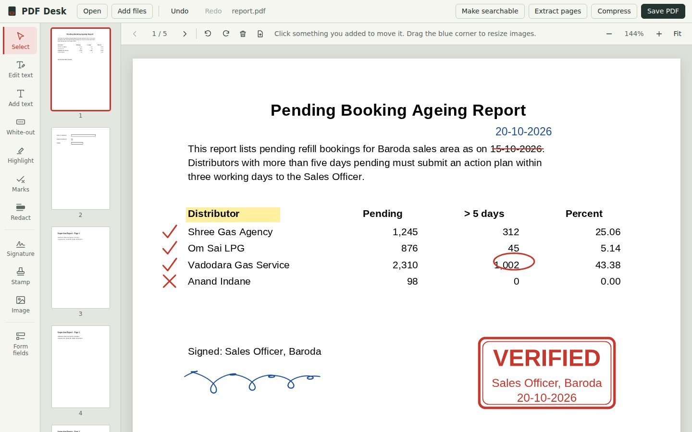

# PDF Desk

**A free PDF editor for Windows. Nothing to install, nothing uploaded.**

PDF Desk is a folder you unzip and open in Chrome or Edge. Editing and text recognition run on your own computer, so your documents never leave it.

## Download

Get the latest zip from **[Releases](https://github.com/nexora-logics/pdfdesk/releases/latest)**, unzip it, and double-click `PDF Desk.html`. Keep the `lib` folder next to it.

Works on Windows 10 and 11 with Google Chrome or Microsoft Edge. No admin rights or internet needed.

## Features

**Correct and review**
- Edit existing text, matching the original size, colour and style
- Add text, highlight and white-out
- Marks: tick, cross, strike off, underline, circle, box, arrow, dot and freehand pen
- Redact: permanently erases confidential details on save

**Sign, stamp and fill**
- Draw or upload your signature; it is remembered for next time
- Stamps such as Approved, Verified and Received, with designation and date
- Fill existing PDF forms
- Build your own fillable forms: text, paragraph, checkbox, dropdown and date fields

**Scans and file size**
- Make scanned pages searchable with OCR (English), then edit their words
- Compress scans and photos for upload limits

**Pages and files**
- Merge, extract pages, reorder, rotate, delete, insert blank pages, photos to PDF, and undo for everything

## Free for everyone

Every feature is free. No trial, no paid version, no account and no ads.

## Privacy

Your PDFs are never uploaded, and the app makes no online requests at all. Note that White-out and Edit text cover old words rather than deleting them; use Redact for anything confidential.

## Built with

[PDF.js](https://github.com/mozilla/pdf.js) (Apache 2.0), [pdf-lib](https://github.com/Hopding/pdf-lib) (MIT) and [Tesseract.js](https://github.com/naptha/tesseract.js) (Apache 2.0).
